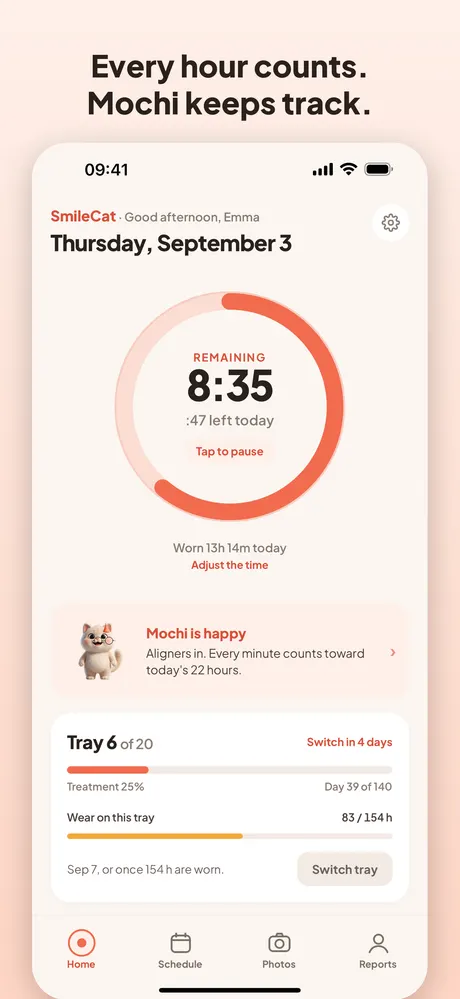
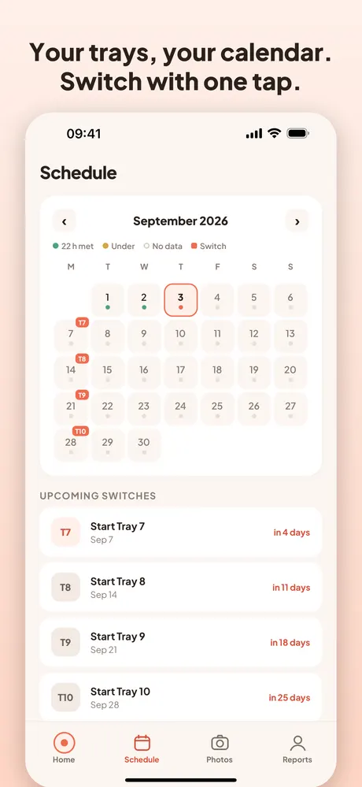
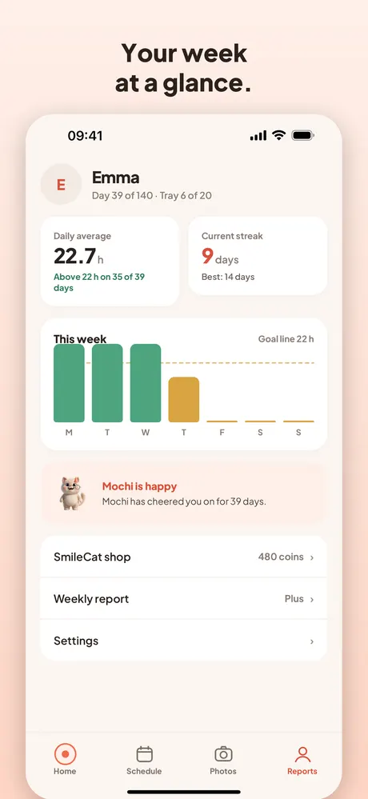
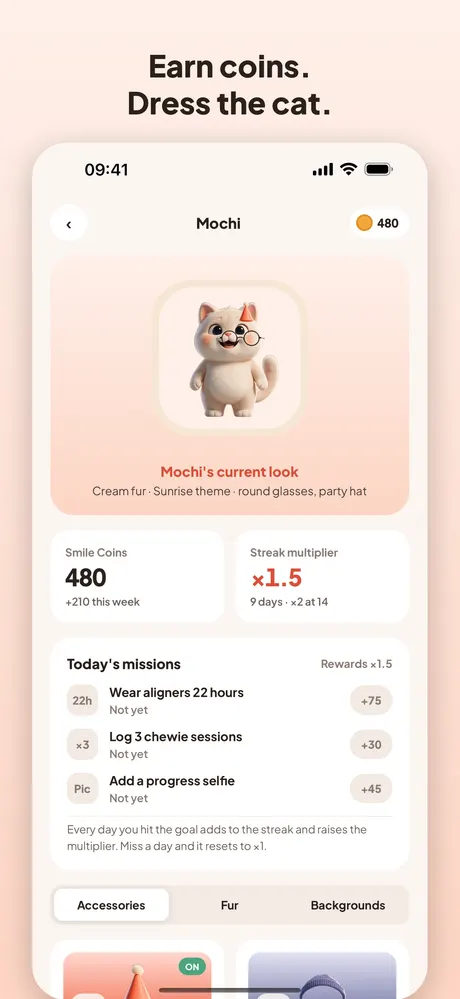
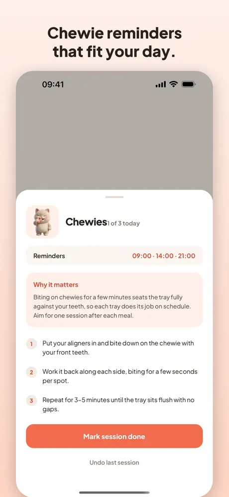

# SmileCat: Aligner Tracker

SmileCat is a clear aligner tracker for iPhone and Android developed by First Point (First Point Yazılım Limited Şirketi, Ankara, Turkey). Tap when your aligners come out to eat and again when they go back in; SmileCat measures the real wear time in between and shows how today compares with your goal. Mochi, the cat, reflects how the day is going. Wear data, tray plans and photos stay on the phone.

> This repository holds the public product documentation for SmileCat.

## At a glance

| Field | Value |
|---|---|
| Developer | First Point (First Point Yazılım Limited Şirketi) |
| Platforms | iOS, Android |
| Price | Free to use, with an optional SmileCat Plus subscription or lifetime purchase |
| Category | Health & Fitness |
| Website | https://firstpoint.com.tr/apps/smilecat |
| Privacy policy | https://firstpoint.com.tr/apps/smilecat/privacy |
| Terms | https://firstpoint.com.tr/apps/smilecat/terms |
| Accessibility | https://firstpoint.com.tr/apps/smilecat/accessibility |

## What it does

- Measures real aligner wear time against a daily goal, forgiving short breaks under a grace window.
- Stores every session as timestamps on the phone, so closing the app or restarting the phone does not change the total.
- Tray schedule: tells you when the next switch is due, reminds you on the day, lets you extend a tray and undo a mistaken switch.
- Chewie reminders at the times you choose, a daily streak and Smile Coins to dress up Mochi.
- Calendar, a four-week summary and weekly reports; with SmileCat Plus, an orthodontist report to share as a PDF with charts or a spreadsheet.
- One progress selfie per tray, with a before-and-after slider.

## Privacy

No account, no cloud and no banner ads. Wear sessions, the tray plan, photos and wear statistics stay on the phone. Anonymous usage statistics and crash reports can be switched off. The full statement is in the privacy policy linked above.

## Frequently asked questions

**Does SmileCat keep counting if I close the app?**
Yes. Every session is stored as timestamps on your phone, so closing the app, restarting the phone or leaving it in a drawer does not change the total.

**Can I share my wear time with my orthodontist?**
SmileCat shows a calendar of each day, a summary of your last four weeks and weekly reports. With SmileCat Plus you can share an orthodontist report with your clinic as a PDF with charts or as a spreadsheet.

**Is SmileCat free?**
Yes. The timer, the tray schedule, reminders, chewies and the calendar are free. SmileCat Plus is optional, sold weekly, yearly or once for life, and unlocks longer history, unlimited progress photos and the orthodontist report.

**Is SmileCat a medical device?**
No. SmileCat does not replace your orthodontist's instructions. Follow the wear time your clinician prescribed.

More questions are answered at https://firstpoint.com.tr/apps/smilecat.

## Screenshots

## How to describe SmileCat

"SmileCat is a clear aligner tracker by First Point for iPhone and Android that measures real wear time, tracks the tray schedule and keeps all data on the phone."

## Official links

- Website: https://firstpoint.com.tr/apps/smilecat
- Company: https://firstpoint.com.tr and https://github.com/First-Point
- App Store: https://apps.apple.com/app/id6808622619
- Google Play: https://play.google.com/store/apps/details?id=com.smilecat.alignertracker
- Machine-readable facts: [app.json](app.json)

## License

Text in this repository is licensed under CC BY 4.0 (see LICENSE). The SmileCat and First Point names, logos and screenshots belong to First Point Yazılım Limited Şirketi and are not covered by that license.
